# Схема подготовки регионального этапа
{: .no_toc }

Схема подготовки регионального этапа до момента «участник пришёл на тур». Ссылки **П.N** — на пункты [Порядка](../poryadok/), **Т.N** — на пункты [Требований к проведению регионального этапа](../trebovaniya-re/).

**T** — начало регионального этапа, день практического тура ([п. 3 Требований](../trebovaniya-re/#p3)).

Обозначения: ■ фиолетовый — ветвление «Да / Нет»; ■ красный — недопуск или отказ; ■ зелёный — старт и выход на тур.

Сокращения: МЭ, РЭ, ЗЭ — муниципальный, региональный, заключительный этап; ВсОШ — всероссийская олимпиада школьников; МПМК — предметно-методическая комиссия Олимпиады; УО — уполномоченная организация; ЛК — личный кабинет; МТО — материально-техническое обеспечение; ОТМ — организационно-технологическая модель; ОМСУ — органы местного самоуправления; ОВЗ — ограниченные возможности здоровья.

## Организатор регионального этапа: подготовка

```mermaid
---
config:
  flowchart:
    curve: basis
    nodeSpacing: 40
    rankSpacing: 36
    padding: 22
    wrappingWidth: 320
  themeVariables:
    fontSize: 26px
    lineColor: "#8a8a8a"
    edgeLabelBackground: "#ffffff"
---
flowchart TD
    R0("`**Субъект РФ планирует провести РЭ**`"):::good
    R1("`**Организатор РЭ** — орган исполнительной власти субъекта РФ в сфере образования
    *П.16*`"):::step
    D0("`**Заявка уже подана и действует?**
    *Т.9*`"):::dec
    R2("`Уполномочить организацию(и) (П.17); подготовить заявку (Прил. №1) с письмами УО о принятии поручения
    *Т.9–11*`"):::step
    D1("`**Заявка подана Учредителю до 1 декабря?**
    *Т.9*`"):::dec
    X1("`РЭ в субъекте не проводится
    *П.18*`"):::bad
    R3("`После верификации — получить доступ к ЛК субъекта
    *Т.12–13*`"):::step
    D2("`**Участие подтверждено в ЛК субъекта до 1 декабря?**
    *Т.14*`"):::dec
    X2("`РЭ в субъекте не проводится
    *Т.14*`"):::bad
    R5("`До 15 декабря — получить перечень МТО
    *Т.21*`"):::step
    R6("`Закупить оборудование, изготовить экспериментальные установки
    *Т.26*`"):::step
    R7("`Не позднее **T−30**: установить и опубликовать минимальный балл МЭ по каждому классу
    *Т.4*`"):::step
    R8("`Не позднее **T−25**: опубликовать список участников по итогам МЭ
    *Т.4*`"):::step
    R9("`Не позднее **T−15**: утвердить ОТМ, уточнить площадки, утвердить составы оргкомитета и жюри, процедуры регистрации, показа и апелляции; установить квоту
    *Т.4*`"):::step
    D3("`**Есть члены жюри с конфликтом интересов?**
    *П.27*`"):::dec
    R10("`Исключить и заменить`"):::step
    R11("`Не позднее **T−15**: проинформировать ОМСУ, школы, участников и родителей о сроках, площадках и квоте
    *Т.4*`"):::step
    R12("`Распределить участников по площадкам (Т.25); пронумеровать рабочие места, спроектировать рассадку с делением на две группы, довести до участников
    *Т.29–30*`"):::step
    D4("`**Есть участники с ОВЗ или дети-инвалиды?**`"):::dec
    R13("`Создать специальные условия, привлечь ассистентов
    *Т.38*`"):::step
    R14("`Создать шифровальную комиссию
    *Т.32*`"):::step
    R15("`Получить комплекты заданий; тиражирование и хранение — по ОТМ
    *Т.31, Т.33*`"):::step
    D5("`**Установки на месте и исправны не позднее чем за 1 рабочий день до практического тура?**
    *Т.27*`"):::dec
    R16("`Устранить недостатки`"):::step
    N1("`**Готовность к туру**`"):::good

    R0 --> R1 --> D0
    D0 -- Нет --> R2 --> D1
    D0 -- Да --> D2
    D1 -- Нет --> X1
    D1 -- Да --> R3 --> R5
    D2 -- Нет --> X2
    D2 -- Да --> R5
    R5 --> R6 --> R7 --> R8 --> R9 --> D3
    D3 -- Да --> R10 --> R9
    D3 -- Нет --> R11 --> R12 --> D4
    D4 -- Да --> R13 --> R14
    D4 -- Нет --> R14
    R14 --> R15 --> D5
    D5 -- Нет --> R16 --> D5
    D5 -- Да --> N1
    D2 ~~~ R5
    D2 ~~~ R5
    D3 ~~~ R11
    D3 ~~~ R11
    D4 ~~~ R14
    D4 ~~~ R14
    D5 ~~~ N1
    D5 ~~~ N1
    D0 ~~~ R2
    D0 ~~~ R2
    D1 ~~~ R3
    D1 ~~~ R3

    classDef step fill:#ffffff,stroke:#cfcfcf,stroke-width:1px,color:#1f1f1f
    classDef dec fill:#f3eeff,stroke:#a882ff,stroke-width:2px,color:#1f1f1f
    classDef bad fill:#fff0f0,stroke:#fb464c,stroke-width:2px,color:#1f1f1f
    classDef good fill:#ecfaf1,stroke:#44cf6e,stroke-width:2px,color:#1f1f1f
```

## Участник: допуск и регистрация

```mermaid
---
config:
  flowchart:
    curve: basis
    nodeSpacing: 40
    rankSpacing: 36
    padding: 22
    wrappingWidth: 320
  themeVariables:
    fontSize: 17px
    lineColor: "#8a8a8a"
    edgeLabelBackground: "#ffffff"
---
flowchart TD
    U0("`**Обучающийся 5–8 класса**, в том числе на семейном образовании или самообразовании
    *П.28*`"):::good
    Q0("`**В субъекте школы проводится РЭ?**
    *П.18, П.31*`"):::dec
    X0("`Участие в РЭ невозможно: другой субъект не допускается
    *П.31*`"):::bad
    Q1("`**Выполнял задания МЭ ВсОШ по физике текущего года за 7 или 8 класс?**
    *П.2, П.29–30*`"):::dec
    X1("`Не допускается к РЭ`"):::bad
    U1("`Класс, за который писал МЭ, — класс участия; сохраняется на РЭ и ЗЭ
    *П.29*`"):::step
    Q2("`**Набрал не меньше минимального балла, установленного организатором для класса?**
    *П.30, Т.4*`"):::dec
    X2("`Не допускается к РЭ`"):::bad
    Q3("`**Включён в список участников, опубликованный не позднее T−25?**
    *Т.4*`"):::dec
    X3("`Не допускается к выполнению заданий
    *Т.36*`"):::bad
    U2("`Родитель в ЛК участника на сайте Олимпиады указывает школу и субъект; при семейном обучении — школу прикрепления
    *Т.22*`"):::step
    U3("`ЛК показывает тексты согласий с наименованиями организатора и УО субъекта; родитель подтверждает ознакомление с Порядком и Требованиями
    *П.32, Т.22*`"):::step
    Q5("`**Родитель дал согласия на обработку и на распространение до ввода сведений?**
    *П.33, Т.22*`"):::dec
    X5("`Участие невозможно
    *П.33*`"):::bad
    U4("`Ввести ФИО, дату рождения, класс обучения, класс участия, контакты участника; ФИО и контакты родителя
    *Т.22*`"):::step
    U5("`В ЛК формируются согласия участника (Прил. №2); распечатать, подписать родителем, а участнику с 14 лет — тоже подписать
    *Т.23–24*`"):::step
    Q6("`**УО требует доп. регистрацию на своём ресурсе?**
    *Т.25*`"):::dec
    U6("`Зарегистрироваться на ресурсе региона, дать ему отдельное согласие, подготовить доп. документы
    *Т.25*`"):::step
    U7("`Следить за публикациями: сроки, площадки, квота (Т.4); площадка и рассадка (Т.25, Т.30); решение о калькуляторах (Т.43). Участие — только на площадке своего субъекта
    *П.31*`"):::step
    U8("`Взять с собой: подписанные согласия и доп. документы, если запрашивались (Т.36); свидетельство о рождении (до 14 лет), паспорт РФ или иной документ; без фото — справка из школы с фото 3×4 и печатью (Т.35); непрограммируемый калькулятор без связи и камеры
    *Т.42–43*`"):::step
    N1("`**Пришёл на тур**: проверка документа, сбор согласий, сверка со списком и ЛК субъекта (Т.35–36); калькулятор — дежурному (Т.43)`"):::good

    U0 --> Q0
    Q0 -- Да --> Q1
    Q1 -- Да --> U1 --> Q2
    Q2 -- Да --> Q3
    Q3 -- Да --> U2 --> U3 --> Q5
    Q5 -- Да --> U4 --> U5 --> Q6
    Q6 -- Нет --> U7
    Q6 -- Да --> U6 --> U7
    U7 --> U8 --> N1
    Q0 -- Нет --> X0
    Q1 -- Нет --> X1
    Q2 -- Нет --> X2
    Q3 -- Нет --> X3
    Q5 -- Нет --> X5
    Q0 ~~~ Q1
    Q0 ~~~ Q1
    Q1 ~~~ U1
    Q1 ~~~ U1
    Q2 ~~~ Q3
    Q2 ~~~ Q3
    Q3 ~~~ U2
    Q3 ~~~ U2
    Q5 ~~~ U4
    Q5 ~~~ U4

    classDef step fill:#ffffff,stroke:#cfcfcf,stroke-width:1px,color:#1f1f1f
    classDef dec fill:#f3eeff,stroke:#a882ff,stroke-width:2px,color:#1f1f1f
    classDef bad fill:#fff0f0,stroke:#fb464c,stroke-width:2px,color:#1f1f1f
    classDef good fill:#ecfaf1,stroke:#44cf6e,stroke-width:2px,color:#1f1f1f
```

